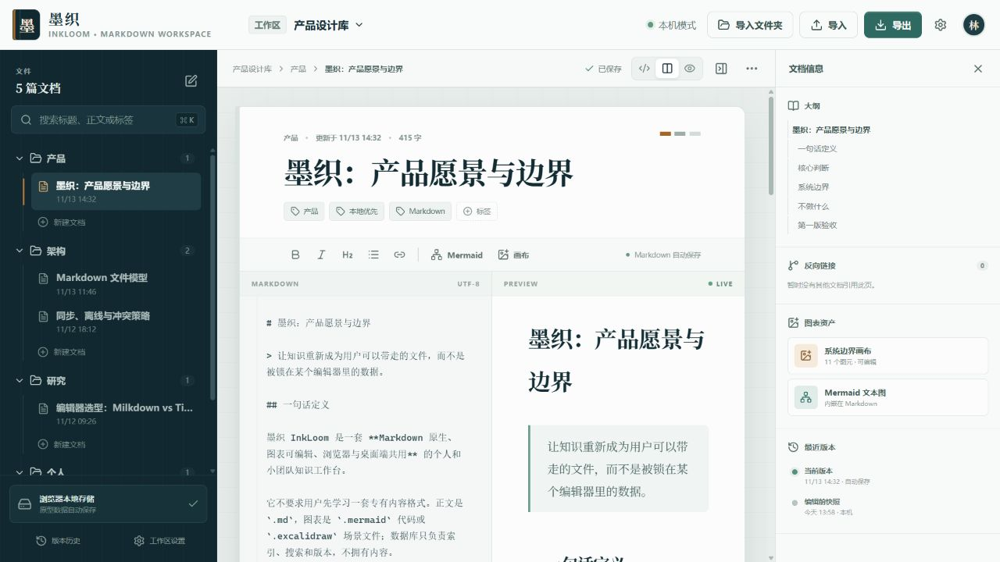

<p align="center">
  
</p>

# InkLoom · 墨织

Markdown-native, file-first knowledge workspace for text, diagrams, and the web.

InkLoom 是一套以 Markdown 为事实源、以普通文件为内容边界、同时提供 Web 与桌面客户端的知识工作台。正文、Mermaid 图表和 Excalidraw 画布都可以编辑、版本化和迁移。



## 项目状态

当前仓库包含一个已验证可运行的 Web 交互原型：

- Markdown 源码、分栏与阅读模式
- 文档目录、搜索、自动保存和导入导出
- Mermaid 图表渲染
- Excalidraw 场景编辑与保存
- 浏览器本地演示存储

桌面客户端、真实磁盘工作区、SQLite 索引和云同步已经完成技术设计，尚未实现。当前任务状态见 [DEVELOP_PLAN.md](./DEVELOP_PLAN.md)，产品与技术方案见 [docs/PRODUCT_AND_ARCHITECTURE.md](./docs/PRODUCT_AND_ARCHITECTURE.md)。

## 快速开始

直接运行已构建的 Web 原型，不需要安装依赖：

```bash
cd apps/web
node serve.mjs
```

打开 `http://127.0.0.1:4173`。

开发模式：

```bash
corepack enable
pnpm install
pnpm dev:web
```

生产构建：

```bash
pnpm build
```

环境要求：Node.js 22.12+、pnpm 12.5.1。桌面端后续要求 Rust stable 与 Tauri 2 所需系统依赖。

## 仓库结构

```text
inkloom/
├─ apps/
│  ├─ web/           @inkloom/web
│  ├─ desktop/       @inkloom/desktop
│  ├─ mobile-tauri/  @inkloom/mobile-tauri
│  └─ harmony/       ArkUI + ArkWeb
├─ packages/
│  ├─ core/          @inkloom/core
│  ├─ editor/        @inkloom/editor
│  ├─ diagrams/      @inkloom/diagrams
│  ├─ storage/       @inkloom/storage
│  ├─ sync/          @inkloom/sync
│  └─ ui/            @inkloom/ui
├─ services/
│  └─ api/           @inkloom/api
├─ docs/
├─ design/
├─ AGENTS.md
├─ DEVELOP_PLAN.md
└─ HANDOFF.md
```

## 域名与部署

部署域名、环境变量与拆分方式见 [docs/DEPLOYMENT.md](./docs/DEPLOYMENT.md)。

## 技术方向

Web、桌面、图表与同步技术选型，以及移动端基础约束，见 [产品与技术方案](./docs/PRODUCT_AND_ARCHITECTURE.md)。

## 参与开发

开发规范见 [AGENTS.md](./AGENTS.md)，贡献流程见 [CONTRIBUTING.md](./CONTRIBUTING.md)。当前原型不是生产文件系统，请勿把 `apps/web` 的 localStorage 实现当作最终存储层。

## License

[MIT](./LICENSE)
