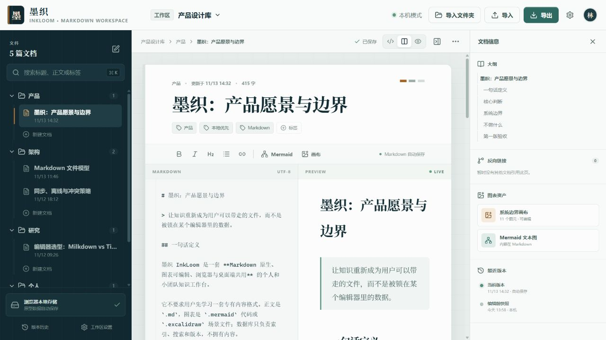
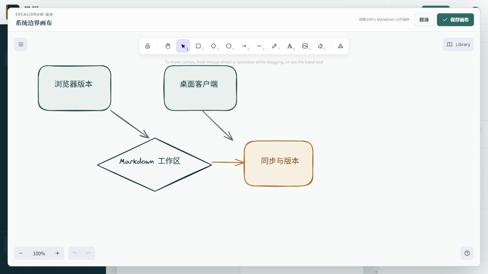
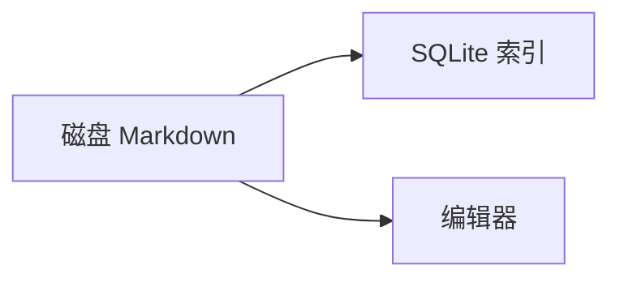
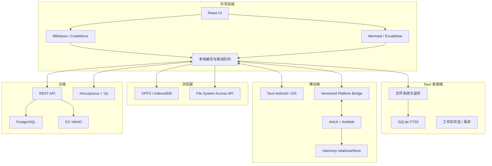

# 墨织 InkLoom：Markdown 原生知识工作台

## 产品与技术调研、实现方案

版本：0.1  
日期：2026-11-13  
项目名：InkLoom  
中文名：墨织  
浏览器域名：`inkloom.imhgl.com`  
配套原型：[apps/web](../apps/web/README.md)

---

## 0. 结论先行

建议做一套 **Markdown 为正文事实源、文件系统为内容边界、图表为可编辑资产、桌面端与浏览器端共享同一前端** 的知识工作台。

推荐技术路线：

| 领域 | 推荐方案 |
| --- | --- |
| 前端 | React + TypeScript + Vite |
| 富文本编辑 | Milkdown Crepe，底层 ProseMirror + Remark |
| 源码编辑 | CodeMirror 6 |
| Markdown 图表 | Mermaid fenced code block，源码直接保存在 `.md` |
| 自由画布 | `@excalidraw/excalidraw`，场景 JSON 独立保存，SVG 作为预览 |
| 桌面客户端 | Tauri 2；Rust 负责文件系统、SQLite、文件监听和系统集成 |
| 本地索引 | SQLite FTS5，索引可从 Markdown 全量重建 |
| 浏览器本地模式 | OPFS/IndexedDB；Chromium 额外支持 File System Access API |
| 云端服务 | Node.js + PostgreSQL + S3/MinIO |
| 实时协同 | Yjs + Hocuspocus，按文档建立 CRDT 会话 |
| 版本历史 | 内容寻址快照 + 可读 Markdown revision |

第一版最重要的产品判断是：**先做可靠的本地知识库，再做类似语雀的云端协作**。这样能先把“文件归属、编辑器体验、图表保存、数据安全”四个核心问题做扎实。

---

## 0.1 开源命名、域名与包结构

`InkLoom` 由 Ink（文本与知识）和 Loom（编织图表、文件、版本与协作）组成，中文名定为“墨织”。项目名、域名与 npm 包作用域统一使用 `inkloom`，避免产品名和工程名分裂。

| 对象 | 约定 |
| --- | --- |
| GitHub 仓库 | `inkloom` |
| 产品名 | `InkLoom` / 墨织 |
| Web 主域 | `https://inkloom.imhgl.com` |
| API | `https://api.inkloom.imhgl.com` |
| 实时协同 | `wss://sync.inkloom.imhgl.com` |
| 静态资源 | `https://cdn.inkloom.imhgl.com`（可选） |
| npm 作用域 | `@inkloom/*` |
| Tauri 标识符 | `com.imhgl.inkloom` |
| 工作区内部目录 | `.inkloom/` |

仓库采用 pnpm workspace：

```text
inkloom/
├─ apps/
│  ├─ web/                 @inkloom/web
│  ├─ desktop/             @inkloom/desktop
│  ├─ mobile-tauri/        @inkloom/mobile-tauri
│  └─ harmony/             ArkUI + ArkWeb
├─ packages/
│  ├─ core/                @inkloom/core
│  ├─ editor/              @inkloom/editor
│  ├─ diagrams/            @inkloom/diagrams
│  ├─ storage/             @inkloom/storage
│  ├─ sync/                @inkloom/sync
│  └─ ui/                  @inkloom/ui
├─ services/
│  └─ api/                 @inkloom/api
├─ docs/
└─ design/
```

依赖方向必须单向：

```text
apps/web ─┐
          ├─> packages/ui ─> packages/core
apps/desktop ┤
apps/mobile-tauri ┤
apps/harmony ┘

apps/* ─> packages/editor
apps/* ─> packages/diagrams
apps/* ─> packages/storage
apps/* ─> packages/sync
services/api ─> packages/core
```

`packages/core` 不依赖 React、Tauri、Node 或浏览器专有 API；文件、网络和数据库能力通过 adapter 注入。

部署环境：

```dotenv
VITE_APP_ORIGIN=https://inkloom.imhgl.com
VITE_API_ORIGIN=https://api.inkloom.imhgl.com
VITE_COLLAB_ORIGIN=wss://sync.inkloom.imhgl.com
VITE_ASSET_ORIGIN=https://cdn.inkloom.imhgl.com
```

Web 前端部署至 `inkloom.imhgl.com`，API 与 Web 使用独立子域，避免后期 Cookie、CORS 与 WebSocket 配置互相耦合。

---

## 1. 产品定义

### 1.1 目标用户

第一阶段优先服务三类用户：

1. 需要长期维护技术文档、方案和会议记录的开发者与产品人员。
2. 希望文档可以用 Git、脚本、其他编辑器处理和迁移的知识工作者。
3. 经常离线写作，同时偶尔需要浏览器访问、分享和多端同步的小团队。

### 1.2 核心用户任务

- 打开一个普通文件夹，把它直接当作知识库。
- 新建文档后立即得到可读的 `.md` 文件。
- 在所见即所得环境中写表格、代码、公式和图表。
- 随时切回源码，确认 Markdown 没有被隐藏格式污染。
- 通过全文搜索、标签、双向链接和大纲找回内容。
- 保存 Mermaid 文本图与 Excalidraw 自由画布，并且以后还能编辑。
- 误删或误改后恢复历史版本。

### 1.3 产品边界

墨织不是“把 Markdown 渲染成网页”的工具，也不是“只支持富文本 JSON”的在线文档。

核心边界：

- 正文事实源必须是 Markdown。
- 数据库不能成为正文唯一副本。
- 图表必须保留可编辑源，而不是只保存 PNG。
- 文件系统与编辑器体验要同时成立。
- 第一版不追求完整企业知识库能力。

### 1.4 功能优先级

**P0：本地单人 MVP**

- 工作区文件夹、目录树、新建/重命名/移动/删除
- Markdown 源码、富文本、分栏、阅读模式
- 自动保存、崩溃恢复、基础版本历史
- 标题/标签/全文搜索
- 相对链接、反向链接、大纲
- Mermaid 图表
- Excalidraw 画布
- 图片粘贴与附件
- Markdown/ZIP 导入导出

**P1：浏览器版与云同步**

- 账号、云端工作区
- Web 与桌面端同步
- 公开只读分享
- 图片与附件对象存储
- 冲突副本与离线队列

**P2：小团队协作**

- 多人实时编辑
- 评论、提及、通知
- 成员与只读/可编辑权限
- 文档发布与团队空间

**P3：智能能力**

- 语义搜索
- 自动生成摘要、标签与图表
- 知识图谱和问答

AI 不应成为第一版的基础依赖。先保证内容可检索、结构可解析和权限边界可靠。

---

## 2. 调研结论与技术取舍

### 2.1 桌面壳：选择 Tauri 2

官方文档说明 Tauri 使用系统原生 WebView，支持 HTML/CSS/JavaScript 前端和 Rust 后端，优势是小体积、安全基础和灵活架构。

选择理由：

- 可以复用浏览器版 React 前端。
- Rust 适合文件监听、原子写、SQLite、内容哈希、系统托盘等能力。
- 安装包通常比 Electron 小，内存占用也更低。
- 文件系统权限可以显式配置，而不是默认暴露 Node.js 全能力。

代价：

- 各平台 WebView 不完全一致，必须覆盖 Windows WebView2、macOS WKWebView、Linux WebKitGTK。
- 团队如果不熟悉 Rust，首期需要额外投入。

备选方案是 Electron：统一 Chromium、文件处理和编辑器兼容性更稳，但安装包和资源占用更大。对于“文件系统型生产力工具”，Tauri 更符合产品定位。

### 2.2 编辑器：Milkdown 优先

Milkdown 官方把自己定位为 Markdown 编辑器，技术上基于 ProseMirror + Remark，支持所见即所得、表格、公式、剪贴板 Markdown 和 Yjs 协同。

选择理由：

- Markdown 解析、编辑和序列化链路更直接。
- 自定义 `mermaid` 和 `excalidraw` 节点比较自然。
- 源码模式和富文本模式可以共享 Markdown 文档模型。
- 许可和扩展方式更适合自建产品。

Tiptap 的优势是协同生态和商业 UI 完整度，但如果产品原则是“Markdown 是事实源”，则必须额外处理富文本节点到 Markdown 的无损映射。最终建议仍保留 Tiptap 作为备选，尤其是团队重心更偏协作而非文件系统时。

### 2.3 浏览器文件系统：能力分级，不假设全平台可写

MDN 记载 File System API 通过用户授权的文件/目录 handle 读写本机文件；OPFS 是来源隔离、对用户不可见的私有文件系统，适合离线缓存和高性能原地写入。

因此浏览器版采用三档能力：

| 模式 | 能力 |
| --- | --- |
| Chromium 本地目录模式 | 用户授权目录，直接读写 `.md` 文件 |
| 通用浏览器本地模式 | 文档存 OPFS/IndexedDB，支持导入导出和离线 |
| 通用浏览器云模式 | 文档存服务器，任意现代浏览器可访问 |

Safari/Firefox 不应被承诺“直接保存到任意本地文件夹”。产品界面需要明确当前存储模式。

### 2.4 全文搜索：SQLite FTS5 作为本地索引

SQLite FTS5 是 SQLite 的全文搜索虚拟表扩展，支持按列索引、`MATCH` 查询和排序。

实现建议：

- 索引正文、标题、路径、标签和链接目标。
- 索引是派生数据，删除 `.inkloom/index.sqlite` 后可完整重建。
- 中文优先使用双字/三元组索引；后续可接专用分词器。
- 云服务端使用 PostgreSQL 全文检索或独立搜索引擎，不依赖客户端索引。

### 2.5 协同：文件同步与字符级 CRDT 分开

Yjs 是不依赖网络协议的高性能 CRDT，可自动合并并发编辑。Hocuspocus 提供基于 WebSocket 的 Yjs 服务端能力，并支持离线后同步。

但不能把全部文件系统状态都塞进一个 Yjs 文档：

- 正文编辑：Yjs 适合合并并发字符操作。
- 文件移动/改名：使用稳定文档 ID 和文件清单同步。
- 附件：使用内容哈希去重和独立对象版本。
- 云端离线冲突：保留版本与冲突副本，不静默覆盖。

### 2.6 图表：两类图表，两种保存方式

**Mermaid**

- 适合流程图、时序图、状态图、甘特图和 ER 图。
- 源码短、可审查、可 Git diff。
- 直接保存在 Markdown fenced code block 中。

**Excalidraw**

- 适合白板、草图、自由布局和视觉表达。
- 场景对象用 `.excalidraw` JSON 保存。
- 同时生成 SVG 预览，让普通 Markdown 阅读器也能看到图。
- Excalidraw 官方支持传入 `elements`、`appState`、`files` 等初始数据，并提供 React 组件嵌入。

---

## 3. 产品体验与视觉方向

### 3.1 信息架构

```text
┌──────────────┬──────────────────────────────────────┬──────────────┐
│ 工作区/文件树 │ 当前文档                             │ 大纲/反链/属性 │
│              │                                      │              │
│ 产品         │ 标题、标签、保存状态                  │ 文档大纲      │
│ 架构         │                                      │ 反向链接      │
│ 研究         │ 源码        │ 实时预览                │ 图表资产      │
│ 个人         │             │                         │ 版本历史      │
│              │                                      │              │
│ 搜索/最近     │ 正文、Mermaid、Excalidraw、表格       │              │
└──────────────┴──────────────────────────────────────┴──────────────┘
```

目录树代表物理文件结构；“最近”“收藏”“标签”“全部图表”属于虚拟视图，不改变磁盘目录。

### 3.2 视觉设计方向

方向定为“可折叠的工程手册”：

- 左侧使用深墨蓝绿色文件书脊，强化“文件夹和工作区”的感觉。
- 中间使用冷白稿纸，不采用通用 SaaS 卡片流。
- 正文采用偏书的行距，UI 采用清晰中文无衬线。
- 铜色只用于图表、章节装饰和关键状态，不做大面积装饰。
- 图表区域使用工程网格底板，明确它是“资产”，不是普通正文。
- 保留键盘焦点、低动态模式、窄屏折叠和阅读宽度控制。

主界面预览：



Excalidraw 画布预览：



### 3.3 关键交互

- `Ctrl/Cmd + K` 搜索。
- `/` 打开块命令，插入标题、表格、Mermaid、画布、附件。
- 自动保存状态只显示“保存中 / 已保存 / 保存失败”，不弹 toast。
- 图表块支持“打开大图 / 编辑源码 / 编辑画布”。
- 双击磁盘中的 `.md` 可打开客户端；客户端关闭后文件仍可被 VS Code、Obsidian、Git 使用。
- 文件名用于用户理解，内部链接优先依赖稳定 `id`，避免改名导致引用断裂。

---

## 4. Markdown 文件系统设计

### 4.1 目录结构

```text
my-workspace/
├─ 产品/
│  ├─ 产品愿景.md
│  └─ 路线图.md
├─ 架构/
│  ├─ 同步设计.md
│  └─ 数据模型.md
├─ assets/
│  ├─ b84f1c...excalidraw
│  └─ b84f1c....svg
├─ .inkloom/
│  ├─ index.sqlite
│  ├─ history/
│  ├─ collab/
│  ├─ workspace.json
│  └─ trash/
└─ .gitignore
```

用户内容位于普通目录中；`.inkloom/` 只存放索引、历史、协同快照和内部状态。

### 4.2 Markdown 文档格式

```md
---
id: 01JQ2GZ9K8WJ5J7J4M1T7Y6K3P
title: 同步设计
created: 2026-11-13T03:20:00Z
updated: 2026-11-13T05:44:00Z
tags: [同步, 架构]
aliases: [离线同步方案]
---

# 同步设计

正文从这里开始。
```

规则：

- `id` 创建后永不改变。
- 改名只改变文件名和 `title`，内部引用仍按 `id` 解析。
- 未知 frontmatter 字段必须原样保留。
- 文件换行统一为 LF，导入时在内存中标准化，不重复改写。
- 不自动删除用户输入的未知 Markdown/HTML/代码块。

### 4.3 链接模型

推荐正文使用标准相对链接，保持可移植：

```md
[数据模型](./数据模型.md)
```

索引器解析目标文件 frontmatter 的 `id`，建立反向链接。可以额外支持 `[[数据模型]]` 快捷输入，但保存时必须可配置为：

- 保留 wiki link，使用扩展解析；或
- 转换为标准相对链接，提升通用兼容性。

默认选择第二种，避免知识库被某一编辑器锁定。

### 4.4 Mermaid 保存

````md

````

保存策略：

- 源码就是图表，直接写回 Markdown。
- 渲染结果不写回正文，避免重复存储。
- 渲染失败时保留源码并显示错误行。
- Mermaid 配置 `securityLevel: "strict"`，防止文档内嵌入不可信 HTML/脚本。

### 4.5 Excalidraw 保存

正式版本建议采用“注释包住预览图”的可移植格式：

```md
<!-- inkloom:canvas
id: c_01JQ3ABCD
scene: ./assets/b84f1c....excalidraw
preview: ./assets/b84f1c....svg
-->

<!-- /inkloom:canvas -->
```

优点：

- 普通 Markdown 渲染器会忽略注释并显示 SVG。
- SVG 可预览、可搜索文件名、可分享。
- `.excalidraw` 保留完整节点、文字、手绘风格和绑定关系。
- 场景文件按内容哈希命名，同一画布重复保存可去重。

原型为了演示简单，使用了 `excalidraw` fenced code block；生产格式以上面的标准链接加 HTML 注释为准。

### 4.6 原子写与文件监听

保存流程：

1. 编辑器产生新内容。
2. 500ms 防抖后写入本地 WAL。
3. 获得文件写入租约。
4. 写入同目录临时文件并 flush。
5. 原子替换目标 `.md`。
6. 更新索引与 revision。
7. 文件监听器用内容哈希识别“自己触发的变更”，避免写回环。

外部编辑器修改同一文件时：

- 若本地没有未保存修改，直接重载。
- 若双方都改过，先保存本地 revision，再生成 `文件名.conflict-<device>-<time>.md`。
- 不允许静默 last-writer-wins 覆盖正文。

---

## 5. 总体架构



### 5.1 共享与差异化

共享：

- UI 组件、文档模型、Markdown 解析器、图表节点、命令系统、主题和快捷键。
- 前端通过 `WorkspaceAdapter` 抽象存储，不直接依赖 Tauri 或浏览器 API。

桌面端实现：

- `LocalFolderAdapter`：真实文件夹、SQLite、文件监听、系统托盘。

浏览器实现：

- `OpfsAdapter`：离线私有文件系统。
- `FileSystemAccessAdapter`：Chromium 授权目录。
- `CloudAdapter`：服务端 API。

移动端实现：

- `TauriMobileAdapter`：Android/iOS 应用沙箱、系统文件选择器、云同步。
- `HarmonySandboxAdapter`：HarmonyOS 应用沙箱、relationalStore、系统文件选择器。
- `PlatformBridge`：统一 ArkWeb/Tauri 与共享前端之间的能力边界。

移动端架构细则见 [ADR 0005](./adr/0005-mobile-ready-foundation.md)。

### 5.2 为什么不用 Electron/浏览器直接操作同一个本地目录作为唯一方案

- 浏览器目录写权限只在部分浏览器可用，且需重复授权。
- Electron 能统一 Chromium，但二进制和内存成本更高。
- Tauri 能用 Rust 处理原子写、文件锁、SQLite 和系统集成，更适合桌面文件系统。

### 5.3 移动端与 HarmonyOS 边界

移动版不把网页简单缩小，也不为每个平台复制业务逻辑。Host 负责系统能力，共享 packages 负责文档语义。

```text
HarmonyOS ArkUI host
├─ native workspace, account, settings, share target
├─ relationalStore metadata/index
├─ system file picker and app sandbox
└─ ArkWeb
   └─ InkLoom React editor

ArkWeb ↔ versioned asynchronous JavaScript bridge ↔ native services
```

强制约束：

- `WorkspacePath` 是逻辑路径，不暴露 Android URI、iOS security-scoped URL、Harmony sandbox absolute path。
- 所有写入都携带 `baseRevision`，发生版本变化时返回冲突，不静默覆盖。
- 移动端以云端工作区和本地离线缓存为主；任意目录访问是可选能力。
- 编辑内容在进入网络同步前必须完成本地持久化，避免后台进程被系统终止时丢失。
- ArkWeb Bridge 只开放白名单方法；特权调用校验来源 URL、工作区权限、消息大小和协议版本。
- 耗时 native 操作只使用异步代理，禁止阻塞 ArkUI 主线程。
- 平台能力通过 `PlatformCapabilities` 暴露，UI 根据能力降级，不根据 user-agent 猜测。
- Excalidraw 在移动端采用全屏触控布局；小屏设备可降级为查看和基础图形编辑。

Tauri 2 官方支持桌面、Android 和 iOS，不支持 HarmonyOS。鸿蒙采用 ArkUI + ArkWeb；Android/iOS 可在完成基础契约后再评估 Tauri 2。

---

## 6. 核心模块实现

### 6.1 编辑器

推荐提供三个视图：

- WYSIWYG：默认写作。
- Source：CodeMirror 6 编辑原始 Markdown。
- Split：源码与预览同步滚动。

统一文档接口：

```ts
interface DocumentEditor {
  load(markdown: string): Promise<void>;
  getMarkdown(): string;
  insertBlock(block: MarkdownBlock): void;
  focusBlock(id: string): void;
  subscribeChange(callback: (next: string) => void): () => void;
}
```

关键验收不是“能渲染”，而是 **Markdown 往返稳定性**：

```text
Markdown A
  -> parse
  -> ProseMirror AST
  -> serialize
  -> Markdown B

assert normalize(A) == normalize(B)
```

建立 golden corpus，覆盖：

- 嵌套列表和任务列表
- 表格中的行内代码
- 脚注、数学公式
- HTML 注释与自定义图表块
- 未知 fenced code language
- 中文标点、软换行、链接 title

凡是无法证明可逆的语法，编辑时降级为只读源码节点，不能静默删除。

### 6.2 Mermaid 节点

自定义 ProseMirror 节点：

- `node.type = mermaidBlock`
- `attr.source` 保存代码
- 序列化为 ` ```mermaid ` fenced code block
- 后台 Web Worker 渲染，主线程只做 SVG 挂载
- mermaid 版本升级前跑视觉回归测试

### 6.3 Excalidraw 节点

编辑流程：

1. 点击图表块，按需加载 Excalidraw bundle。
2. 从 `.excalidraw` 文件读取 `elements`、`appState`、`files`。
3. 编辑过程中每 2 秒写临时快照，防止崩溃。
4. 关闭时保存新 `.excalidraw` revision。
5. 导出 SVG，更新稳定预览文件。
6. Markdown 节点只保存引用、尺寸、标题和预览路径。

注意：

- `initialData` 每次打开只构造一次，避免 React 反复重建 scene。
- 画布场景与正文分开保存，避免大 JSON 影响 Markdown diff。
- Excalidraw bundle 必须懒加载。

### 6.4 索引

索引表建议：

```sql
documents(
  id TEXT PRIMARY KEY,
  path TEXT UNIQUE,
  title TEXT,
  content_hash TEXT,
  updated_at TEXT,
  revision INTEGER
);

document_fts USING fts5(
  id UNINDEXED,
  title,
  body,
  tags,
  tokenize = 'trigram'
);

links(
  source_id TEXT,
  target_id TEXT,
  target_path TEXT,
  link_text TEXT
);

assets(
  id TEXT PRIMARY KEY,
  hash TEXT,
  mime TEXT,
  size INTEGER,
  path TEXT
);

revisions(
  id TEXT PRIMARY KEY,
  document_id TEXT,
  content_hash TEXT,
  created_at TEXT,
  source_device TEXT,
  label TEXT
);
```

索引更新使用文件监听 + 内容哈希。文件系统是事实源；索引损坏时可重建。

### 6.5 版本历史

建议：

- 输入时更新 WAL，不必每个字符生成版本。
- 静止 2 秒后生成一次快照。
- 持续编辑时最长 30 秒生成一次检查点。
- 手动保存、标题修改、图表替换和冲突恢复生成显式版本。
- 默认保留 30 天或最近 200 个版本，空间按工作区配置。

数据安全要求：

- 版本文件写入成功前不能删除旧版本。
- 回收站保留原相对路径和文档 ID。
- 导出必须能带出正文、附件和图表场景。

### 6.6 同步协议

第一版云同步只同步“已完成的文档 revision”，不同步每个按键。

同步操作：

```ts
type SyncOp =
  | { kind: "upsert-node"; node: FolderNode; baseRevision: number }
  | { kind: "delete-node"; nodeId: string; baseRevision: number }
  | { kind: "put-document"; documentId: string; hash: string; baseRevision: number }
  | { kind: "put-asset"; hash: string; mime: string; size: number };
```

每次请求携带：

- `deviceId`
- `workspaceId`
- `baseRevision`
- 内容哈希

冲突处理：

- 目录项改名/移动：按节点 ID 做显式冲突提示，不按文件名猜测。
- 文档双端修改：两份都保留，优先进行三向合并；失败则创建冲突副本。
- 附件同名替换：内容寻址，不覆盖旧文件。

### 6.7 实时协作

实时协作不是第一版必选。启用时：

- 每篇文档一个 `Y.Doc`。
- ProseMirror 通过 Yjs binding 同步。
- Hocuspocus 负责 WebSocket 会话和持久化。
- 定期把 Yjs 状态序列化成 Markdown。
- 只有获取“固化租约”的进程可以写 `.md`。
- 序列化后做 AST 等价校验，失败则保留源码并告警。

---

## 7. 云端 API 草案

```text
GET    /api/workspaces
POST   /api/workspaces
GET    /api/workspaces/:id/tree
GET    /api/documents/:id
PUT    /api/documents/:id
GET    /api/documents/:id/revisions
POST   /api/documents/:id/restore
POST   /api/assets/upload-url
GET    /api/search?q=...
GET    /api/workspaces/:id/sync?afterRevision=123
```

WebSocket：

```text
/collaboration/:workspaceId/:documentId
```

对象存储：

- 正文 revision 也可作为内容寻址对象保存。
- 缩略图、SVG、附件使用预签名 URL 上传。
- 服务端校验哈希、MIME、体积和工作区权限。

---

## 8. 数据安全与安全边界

### 8.1 本地文件

- 所有路径先 `realpath`，必须位于工作区根目录内。
- 默认禁止跟随指向工作区外的符号链接。
- 文件名非法字符统一处理，但保留用户原命名习惯。
- 附件限制大小和类型；可执行文件只可下载，不可内嵌执行。
- 写文件采用临时文件 + 原子替换。

### 8.2 渲染安全

- Markdown HTML 使用 DOMPurify 白名单。
- Mermaid 使用 strict 安全级别。
- 外链统一 `rel="noreferrer"`，可按策略禁止内嵌 iframe。
- Excalidraw 禁止嵌入任意可执行网页。
- 设置严格 CSP，禁止远程脚本注入正文。

### 8.3 云端

- 文档、附件、revision 均做工作区级权限检查。
- 分享链接区分只读、可评论、可编辑。
- 数据库不保存明文第三方密钥；桌面端密钥使用系统 Keychain。
- 日志不打印正文，只打印文档 ID、哈希、状态和耗时。

---

## 9. 性能目标

以 10,000 篇文档、平均 20KB、总附件 10GB 的工作区为第一阶段目标：

| 指标 | 目标 |
| --- | --- |
| 首次加载 1MB 文档 | 小于 500ms |
| 文档切换 | P95 小于 150ms |
| 自动保存到本地 | 500ms 防抖后小于 100ms 完成 |
| 全文搜索 | P95 小于 120ms |
| Mermaid 首次渲染 | 小于 500ms，复杂图可异步 |
| Excalidraw 首次打开 | 小于 1.5s，后续命中缓存 |
| 启动重建索引 | 10,000 篇小于 3 分钟 |
| 单文档版本开销 | 默认不超过正文大小的 1.2 倍/版本 |

工程措施：

- Excalidraw 与 Mermaid 图表模块按需加载。
- 长文档分块渲染，编辑器只挂载可视区域附近。
- 搜索索引与文件监听放在 Worker 或 Rust 后台线程。
- SVG 预览写入缓存，正文滚动不重复渲染画布。

---

## 10. 实施路线

### 阶段 0：交互与数据模型验证（1 周）

交付：

- 本仓库交互原型
- Markdown 文件格式样例
- Mermaid / Excalidraw 保存策略
- 用户可评审的视觉方向

退出条件：

- 能明确接受目录树 + 稿纸 + 右侧信息栏布局。
- 能确认“Markdown 为唯一正文事实源”的原则。

### 阶段 1：桌面本地 MVP（3–5 周）

交付：

- Tauri 2 客户端
- 打开/创建工作区文件夹
- Milkdown + CodeMirror 双模式
- SQLite 索引与全文搜索
- Mermaid/Excalidraw 完整保存
- 历史版本、回收站、原子写
- Markdown/ZIP 导入导出

退出条件：

- 断网时全部核心功能可用。
- 用 VS Code 修改文件后客户端可正确刷新。
- 1000 篇文档的搜索、切换、保存达到性能目标。

### 阶段 2：浏览器与云同步（3–4 周）

交付：

- 账号和工作区
- 浏览器云模式
- Web/桌面双向同步
- 离线队列与冲突副本
- 分享链接

退出条件：

- 两端离线修改同一文档后不会静默丢失。
- 浏览器刷新、崩溃、断网恢复不损坏正文。

### 阶段 3：实时协作与团队（3–5 周）

交付：

- Yjs/Hocuspocus
- 光标、在线状态、评论
- 成员权限
- 团队空间和发布页

退出条件：

- 两人并发编辑后 Markdown 可稳定固化。
- 权限撤销后现有连接和分享链接立即失效。

若只有 1 名开发者，建议把总周期按 1.6–2 倍估算，并优先只做 Windows 桌面版。

---

## 11. MVP 验收清单

### 内容可靠性

- [ ] 新建文档后磁盘立即出现 `.md`。
- [ ] 关闭客户端后可用记事本/VS Code 正常打开。
- [ ] 未知 Markdown 语法不会被删除。
- [ ] 外部修改文件后可刷新或提示冲突。
- [ ] 崩溃恢复最多丢失最后 2 秒输入。

### 图表

- [ ] Mermaid 源码随 `.md` 保存。
- [ ] Excalidraw 节点、文字、图片、绑定关系可恢复。
- [ ] 图表预览可在普通 Markdown 阅读器显示。
- [ ] 图表渲染失败不会清空源码。

### 搜索与链接

- [ ] 标题、正文、标签、路径均可搜索。
- [ ] 文档改名后反向链接不丢失。
- [ ] 删除索引文件后能自动重建。

### 数据安全

- [ ] 路径穿越和符号链接不能访问工作区外文件。
- [ ] HTML/Mermaid 内容不能执行未授权脚本。
- [ ] 删除进入回收站，历史版本可恢复。

---

## 12. 主要风险与应对

| 风险 | 影响 | 应对 |
| --- | --- | --- |
| Markdown 往返丢格式 | 用户不信任编辑器 | golden corpus、未知节点保源、可切源码 |
| 浏览器本地写能力碎片化 | Web 版承诺过大 | 能力分级，Chromium 目录模式，其他走 OPFS/云 |
| Excalidraw 包体积大 | 首屏慢 | 懒加载、独立 chunk、SVG 预览缓存 |
| 文件监听循环写入 | 数据重复或冲突 | 内容哈希、写入租约、忽略自身事件 |
| 双端离线冲突 | 正文丢失 | baseRevision、冲突副本、三向合并 |
| Yjs 与 Markdown 固化不一致 | 协同内容消失 | 单写者租约、AST 等价校验、强制快照 |
| Tauri WebView 差异 | UI/输入法问题 | 三平台测试，关键粘贴/中文输入回归 |
| 中文全文搜索效果 | 搜索不可用 | 双字/trigram 索引，独立分词基准测试 |
| 图表依赖链漏洞 | 供应链与脚本执行风险 | 锁定版本、`npm audit` 门禁、跟进 Excalidraw/Mermaid 修复版本 |

原型依赖检查显示：生产依赖存在 9 个 high、1 个 moderate、2 个 low 的已知问题，主要来自 Excalidraw 的 Mermaid 转换依赖链和传递依赖。它们不等同于已可利用漏洞，但正式产品上线前必须升级、替换或明确隔离，不能用演示原型直接进入生产。

---

## 13. 配套原型说明

原型位于：[apps/web](../apps/web/README.md)

无需安装依赖：

```powershell
cd apps/web
node serve.mjs
```

打开 `http://127.0.0.1:4173`。

原型已经验证：

- 文档树、搜索、新建与删除
- Markdown 自动保存和三种视图
- Mermaid SVG 渲染
- Excalidraw 场景加载、编辑和保存
- Markdown 导入与导出

原型未实现生产级文件写入、云同步、账号和实时协作。这些边界在主方案中已经拆成后续阶段。

---

## 14. 参考资料

以下资料用于核对技术边界，访问日期为 2026-11-13：

1. [MDN File System API](https://developer.mozilla.org/en-US/docs/Web/API/File_System_API)：文件/目录 handle、OPFS、保存与访问模型。
2. [Tauri 2: What is Tauri?](https://v2.tauri.app/start/)：系统 WebView、小体积、Rust 后端。
3. [Tauri File System Plugin](https://v2.tauri.app/plugin/file-system/)：桌面文件访问、权限与 scope。
4. [Milkdown Getting Started](https://milkdown.dev/docs/guide/getting-started)：Markdown 编辑、ProseMirror + Remark、表格、公式、Yjs。
5. [Mermaid Introduction](https://mermaid.js.org/intro/)：文本定义生成图表，适合文档维护。
6. [Mermaid Usage](https://mermaid.js.org/config/usage.html)：运行环境与安全配置入口。
7. [Excalidraw Integration](https://docs.excalidraw.com/docs/@excalidraw/excalidraw/integration)：React/模块打包器嵌入方式。
8. [Excalidraw initialData](https://docs.excalidraw.com/docs/@excalidraw/excalidraw/api/props/initialdata)：elements、appState、files 的持久化输入。
9. [Yjs Introduction](https://docs.yjs.dev/)：CRDT、离线同步与编辑器支持。
10. [Hocuspocus Introduction](https://tiptap.dev/docs/hocuspocus/introduction)：Yjs WebSocket 协同服务。
11. [SQLite FTS5](https://www.sqlite.org/fts5.html)：本地全文索引能力。
12. [Tauri Develop](https://v2.tauri.app/develop/)：桌面及 Android/iOS 移动开发流程。
13. [HarmonyOS ArkWeb_ControllerAPI](https://developer.huawei.com/consumer/cn/doc/harmonyos-references/capi-web-arkweb-controllerapi)：JavaScript 注入、同步/异步代理、Web Message Port 和来源 URL。
14. [HarmonyOS relationalStore](https://developer.huawei.com/consumer/cn/doc/harmonyos-references/js-apis-data-relationalstore)：基于 SQLite 的关系型数据库能力。

